# Habla Fluido

**Alumno:** Omar Mendez · **Grupo:** GTID243

## Evidencias por ronda

### Ronda 2: Comparador de frases (12 tests)

Pruebas de normalizar, distancia y similitud, y comparar.

**ROJO:**

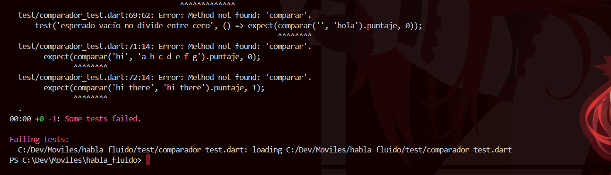

**VERDE:**

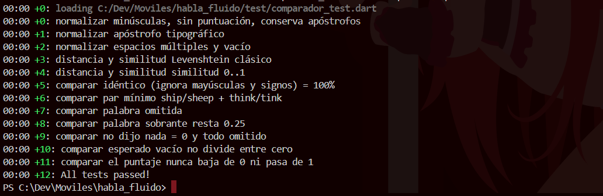

### Ronda 3: Repetición espaciada SM-2 (8 tests)

**ROJO:**

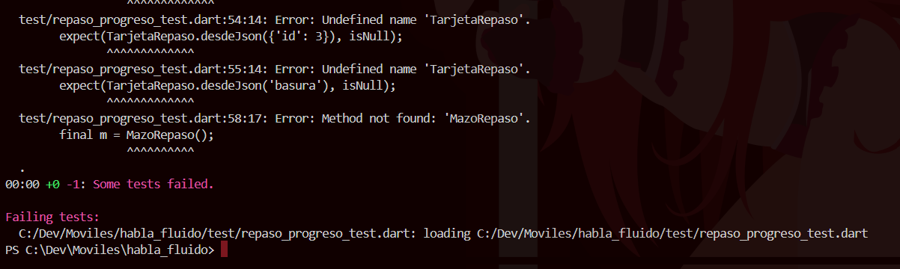

**VERDE:**

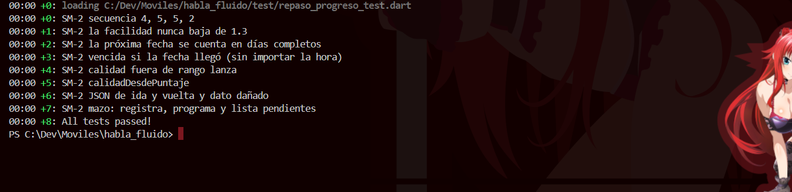

### Ronda 4: Progreso, nivel y plan diario (12 tests)

Estas pruebas están en el mismo archivo que las de la Ronda 3, `repaso_progreso_test.dart`, y se separan por grupo.

**ROJO:**

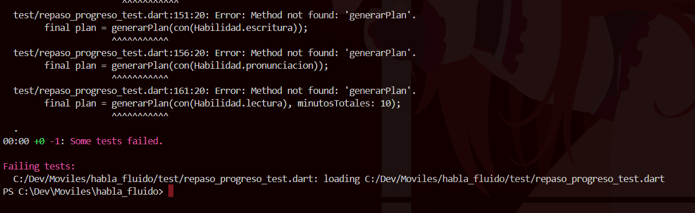

**VERDE:**

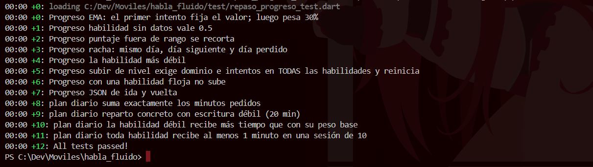

### Ronda 6: Proxy del tutor en Node (12 tests)

**ROJO:**

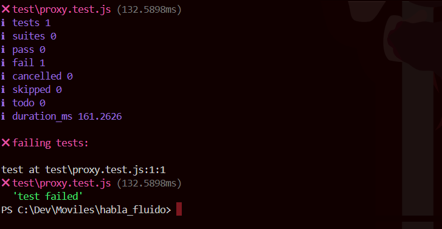

**VERDE:**

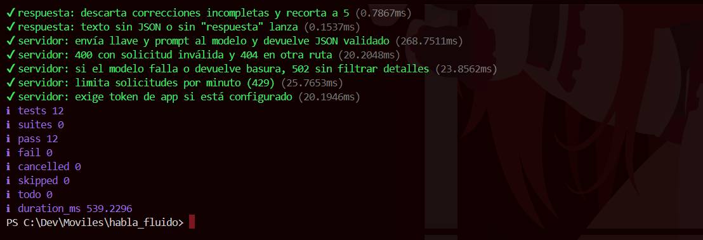

### Ronda 7: Tutor simulado y cliente HTTP (17 tests)

Incluye las pruebas de `RespuestaTutor.desdeTexto`, que prueban código de la Ronda 5 pero el manual las incluye en `tutor_test.dart`.

**ROJO:**

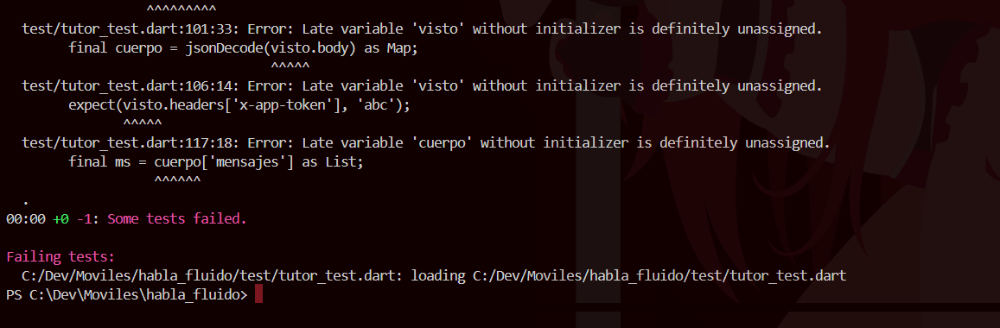

**VERDE:**

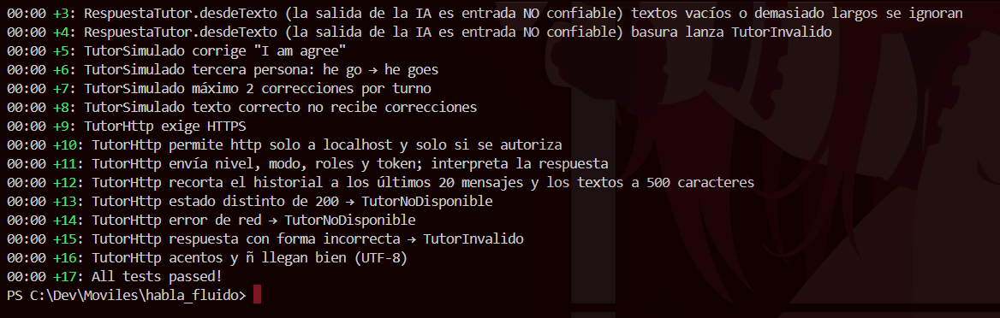

### Ronda 9: ViewModels de cada ejercicio (29 tests)

**ROJO:**

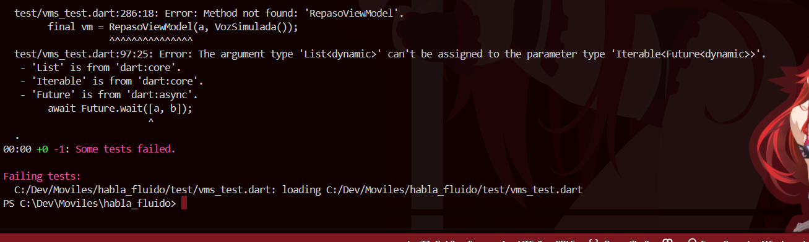

**VERDE:**

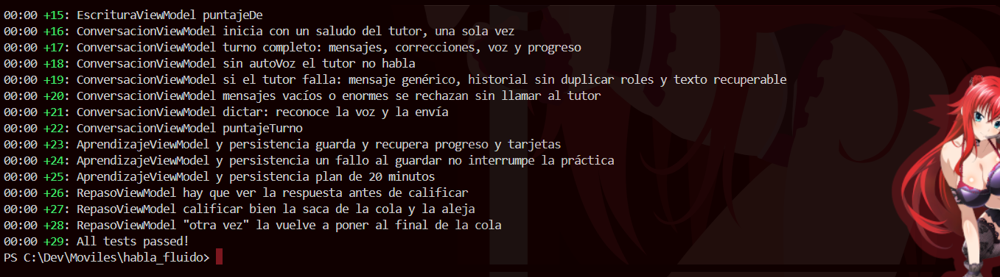

## Ejecución completa

**Pruebas de Flutter (78 tests):**

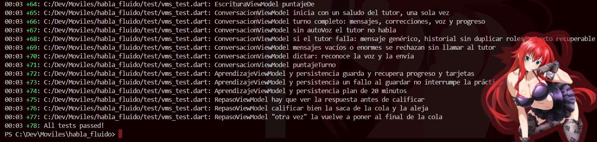

**Pruebas del proxy en Node (12 tests):**

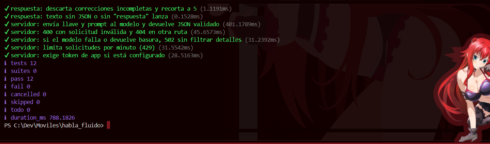

## Interfaz de la App

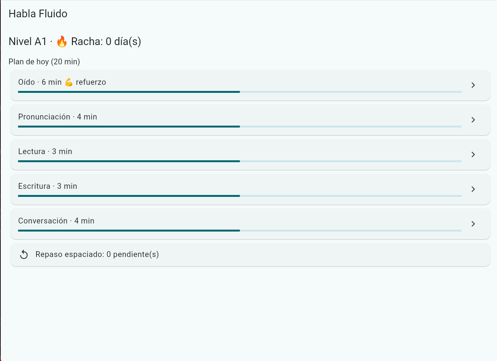

## Rondas sin pruebas automatizadas

El manual no incluye pruebas en las rondas 1, 5, 8, 10, 11 y 12, por eso no tienen capturas de rojo y verde. Esto es lo que define cada una:

- **Ronda 1:** creación del proyecto, paquetes, permisos de micrófono y archivos base (reglas, niveles y excepciones).
- **Ronda 5:** catálogo de frases, lecturas y contratos del tutor, la voz y el almacén de avance. La lógica de esta ronda (interpretar la respuesta del tutor) se prueba en la Ronda 7.
- **Ronda 8:** voz real (flutter_tts y speech_to_text) y voz simulada. La voz real requiere un teléfono con micrófono; la lógica que la usa se prueba con la voz simulada en la Ronda 9.
- **Ronda 10:** pantallas y raíz de composición.
- **Ronda 11:** diseño de evaluación del aprendizaje (no es código).
- **Ronda 12:** privacidad, ética, costos y producción (no es código).